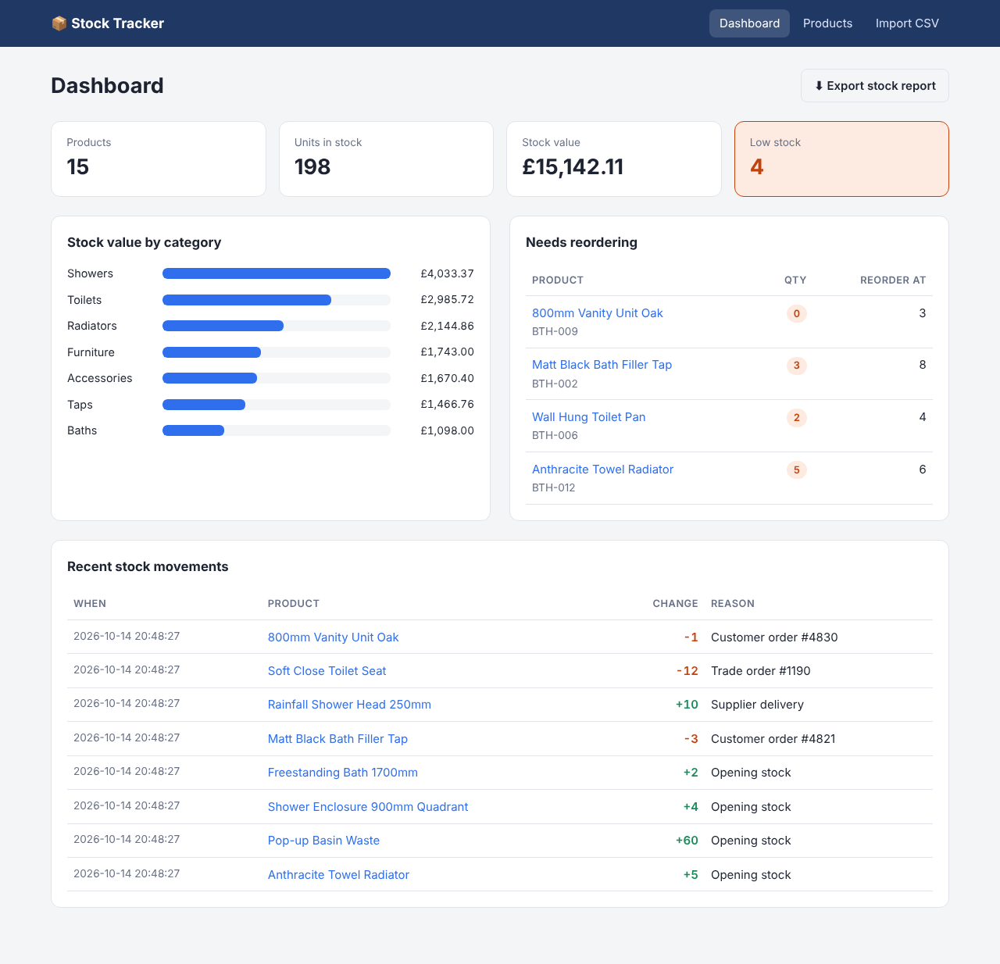

# 📦 Stock Tracker

A web app for managing product inventory: track stock levels, record every stock movement, get low-stock alerts, and import or export product data as CSV.

I built it because of my job as a Data Administrator at a bathroom wholesaler, where I manage 4,000+ product records. Stock is often tracked in spreadsheets, and errors creep in when nobody can see who changed a quantity or why. This app keeps a full history of every change and validates data before it goes in.

> Built with AI assistance (Claude). I reviewed, ran and tested all of the code, and can explain how each part works.



## Features

- **Dashboard** with total products, units, stock value (£) and low-stock count, plus stock value by category and a reorder list
- **Products**: add, edit, delete, search by name or SKU, and filter by category or low stock
- **Stock movements**: record stock in and out with a reason. Every change is logged, and stock can never go below zero
- **CSV import** with validation. New SKUs are added and existing SKUs are updated. Bad rows are skipped and reported by row number, so one mistake doesn't block the whole file
- **CSV export** of a stock report with stock value and LOW/OK status
- **18 automated tests** covering validation, stock rules, CSV import/export and every page

## Tech stack

| Layer | Tools |
|---|---|
| Backend | Python 3, Flask |
| Database | SQLite with hand-written SQL (`app/schema.sql`, `app/services.py`) |
| Frontend | Jinja templates, HTML, CSS (responsive, automatic dark mode) |
| Testing | Python `unittest` (also runs under `pytest`) |

## Project structure

```
stock-tracker/
├── app/
│   ├── __init__.py      # creates the Flask app (application factory)
│   ├── db.py            # database connection + CLI commands (init-db, seed)
│   ├── schema.sql       # table definitions: products, movements
│   ├── services.py      # business rules: validation, stock movements, CSV, reports
│   ├── routes.py        # web pages and forms (thin, they call services.py)
│   ├── templates/       # HTML pages (Jinja)
│   └── static/style.css
├── sample_data/products.csv
├── tests/test_app.py
└── requirements.txt
```

## Run it locally

```bash
# 1. Create a virtual environment and install Flask
python -m venv venv
venv\Scripts\activate          # Windows
# source venv/bin/activate     # macOS / Linux
pip install -r requirements.txt

# 2. Load the sample products (optional)
flask --app app seed

# 3. Start the app, then open http://127.0.0.1:5000
flask --app app run
```

## Run the tests

```bash
python -m unittest discover -s tests -v
```

## Design decisions

- **Quantities only change through stock movements.** The edit form can't change quantity directly, so every change has a reason and a timestamp, which gives a full audit trail.
- **Rules live in `services.py`, not in the routes.** This keeps the pages simple and lets the rules be tested on their own.
- **Plain SQL instead of an ORM**, so every query is visible. The dashboard uses `SUM`, `CASE WHEN` and `GROUP BY` to calculate the figures in the database.
- **Database constraints as a safety net**: `CHECK (quantity >= 0)` and a `UNIQUE` SKU stop bad data even if the code had a bug.

## Ideas for next steps

- User logins with roles (admin / viewer)
- Charts of stock over time
- Deploy online (e.g. Render or PythonAnywhere)
